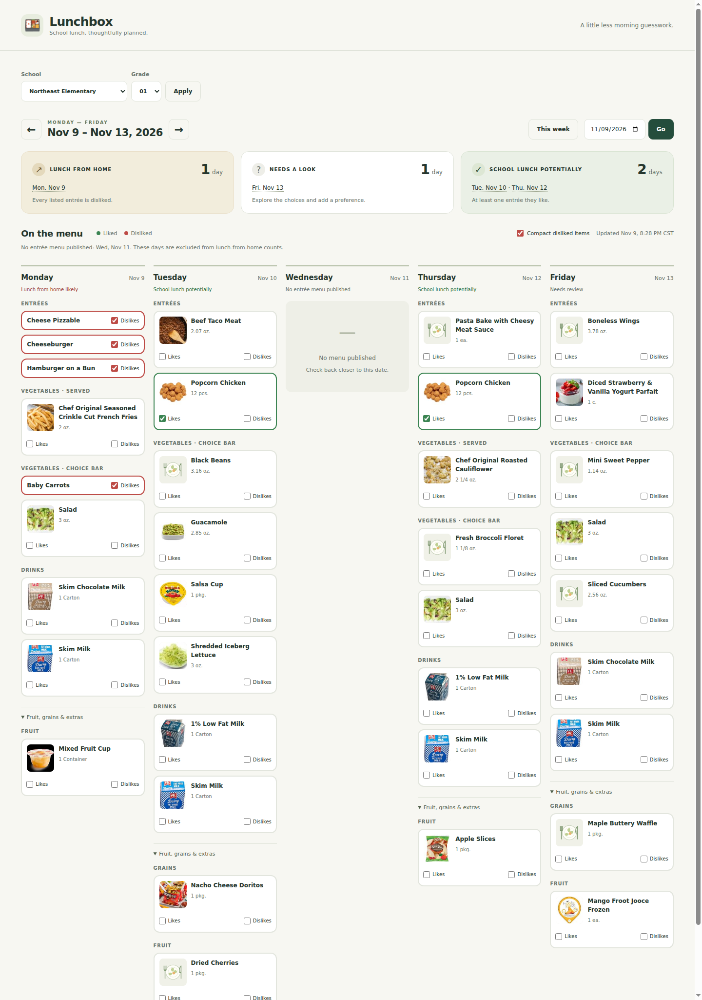
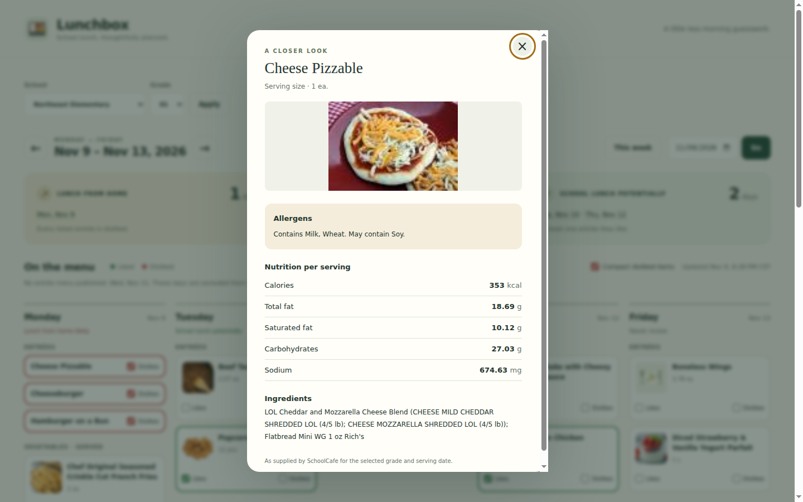
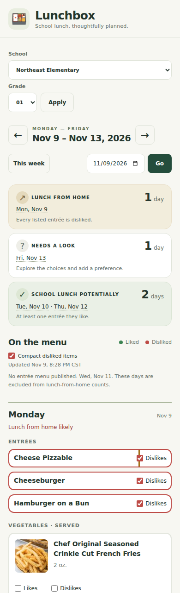

# Lunchbox · SchoolCafe family menu

A Dockerized Django application for Monday–Friday school menus, food photos, allergen and nutrition details, and a lunch-from-home summary based on one child's SQLite-backed preferences.

## Run with Docker

```bash
cp .env.example .env
python3 -c 'import secrets; print(secrets.token_urlsafe(48))'
# Set DJANGO_SECRET_KEY in .env to the generated value.
docker compose build
docker compose run --rm web python manage.py migrate --noinput
docker compose up -d --wait
```

Open [localhost:8000](http://localhost:8000). A private `.env` was generated for the initial local deployment; keep that file when restarting this installation.

Defaults match the original API client: **Northeast Elementary**, **grade 01**, **Lunch**, **A Line**, and **America/Chicago**. The grade selector includes **01–05**, verified against Northeast Elementary's weekly menu endpoint. Select another school on the page; check its grade availability before configuring additional codes through `SUPPORTED_GRADES`.

## Using the planner

- Weekdays open the current Monday–Friday menu. Saturdays and Sundays open the upcoming Monday–Friday menu: Sunday, November 8 opens November 9–13. The shortcut reads “Upcoming week” on weekends and “This week” on weekdays. Previous/next, date selection, and bookmarks preserve school and grade.
- Entrées, vegetables, and drinks have separate sections. Fruit and grains are available under each day's extras.
- Select a food for serving size, source allergen wording, calories, total/saturated fat, carbohydrates, sodium, and available ingredients. Missing photos use a local illustration.
- **Likes** and **Dislikes** are mutually exclusive. Uncheck the selected box to clear it. Green/red outlines indicate the saved preference, which follows the food across menu dates, schools, and household browsers.
- **Compact disliked items** is enabled by default. Disliked cards shrink to the food name and an accessible Dislikes checkbox; switch the control above the menu off to restore the full cards. This display preference is stored in the browser.
- A day is **lunch from home likely** only when its nonempty, complete entrée list is entirely disliked. At least one liked entrée means **school lunch potentially**. Other published choices **need review**. Missing menus are listed separately and do not imply school closure.

Menu data is cached. A source outage can use a clearly labeled saved menu for up to 24 hours. Preference saves do not require SchoolCafe and are never sent to it. This is a shared household application with one default child profile, not a multi-account service.

## Screenshots

These representative views use captured SchoolCafe sample data and synthetic preferences in an isolated demo database.







The `schoolcafe_data` Docker volume stores `/data/schoolcafe.sqlite3` and its WAL files. The non-root runtime uses Gunicorn and locally served static assets. Readiness is available at `/health/ready`. See [deployment, backups, updates, and household access](docs/DEPLOYMENT.md).

## Publish to Docker Hub

The [publishing workflow](.github/workflows/publish.yml) follows `poke-games`: configure the GitHub repository secrets `DOCKER_USERNAME` and `DOCKER_PASSWORD` (a Docker Hub access token with write permission), then push a version tag such as `v1.0.0`. The complete validation workflow must pass before publication.

A stable `v1.0.0` release publishes `<DOCKER_USERNAME>/lunchbox:1.0.0` and `<DOCKER_USERNAME>/lunchbox:latest`. Prerelease tags publish their version without advancing `latest`. Local builds use `lunchbox:local`; the CI test image is `lunchbox:test`.

To run a published release, set `LUNCHBOX_IMAGE=your-dockerhub-username/lunchbox:1.0.0` in `.env`, then:

```bash
docker compose pull web
docker compose run --rm --no-build web python manage.py migrate --noinput
docker compose up -d --no-build --wait
```

See [release setup and updates](docs/DEPLOYMENT.md#docker-hub-releases) for the repository settings, tag commands, and update procedure.

## Development and checks

Use Python 3.13 or 3.14 and a Node version compatible with the locked test tooling (tested locally on 22.22.1):

```bash
python3 -m venv .venv
.venv/bin/python -m pip install -r requirements-dev.lock
npm ci
.venv/bin/ruff check schoolmenu tests scripts manage.py schoolcafe_client.py
.venv/bin/ruff format --check schoolmenu tests scripts manage.py schoolcafe_client.py
.venv/bin/mypy schoolmenu
.venv/bin/python -m pytest tests/unit tests/integration --cov=schoolmenu --cov-branch --cov-report=json --cov-report=xml
.venv/bin/python scripts/check_coverage.py coverage.json
npm run format:check
npm run test:coverage
.venv/bin/playwright install chromium
.venv/bin/python -m pytest tests/e2e --tracing=retain-on-failure
python3 scripts/docker_smoke.py
```

The smoke script requires Docker, `.env`, and the built `lunchbox:local` production image. It creates a uniquely named isolated project and volume, verifies that local image even when `.env` selects a published release, and removes only its own test resources. To use installed Chrome in browser tests, set `PLAYWRIGHT_CHROMIUM_EXECUTABLE` to its executable path.

For local development, set `DJANGO_SECRET_KEY` in the environment, then run `manage.py migrate`, `manage.py collectstatic --noinput`, and `manage.py runserver` using the virtual environment. Local development does not automatically load `.env`; Compose does. Test settings use an isolated key/database and fixture-backed transport. Production contains no fixture switch or test-data endpoint.

The minimum is **96% independently for Python lines and branches**, with separate gates for client/domain/services. Custom JavaScript has the same minimum for lines, branches, statements, and functions. Generated migrations and entry points are excluded from coverage; migrations and browser entry points are exercised by integration/container/browser checks. [CI](.github/workflows/ci.yml) runs Python 3.13/3.14, browser, JavaScript, and Docker checks.

See [recorded release verification](docs/VALIDATION.md) for the executed checks and measured coverage.

## Source and API evidence

- [Original design](docs/IMPLEMENTATION_PLAN.md).
- [API findings](docs/API_FINDINGS.md) and [captured responses with checksums](docs/api_samples/manifest.json).
- [Provider client](schoolmenu/provider.py), refactored from the original script. `schoolcafe_client.py` retains import and CLI compatibility.

Nutrients remain as supplied, without reapplying `NutrientFactor`. Daily ingredient enrichment preserves weekly sodium and saturated fat, which the daily response omits.
