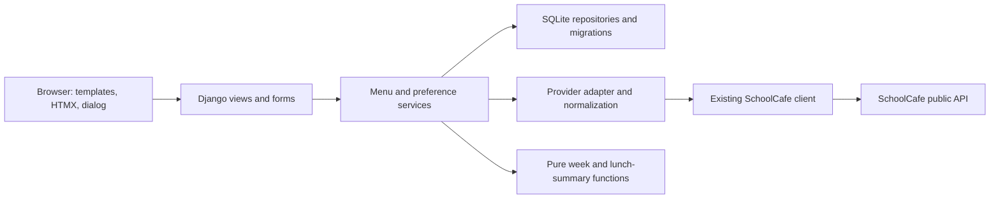

# SchoolCafe family menu: design and implementation plan

## Deliverable and decisions

Build a Dockerized Python application for browsing Monday–Friday school lunches, recording one child's food preferences in SQLite, and identifying days likely to need lunch from home. This document is the build plan; the runtime application and deployment are future implementation work.

The plan is based on seven actual API responses described in [API findings](API_FINDINGS.md), rather than assumptions about the proof-of-concept client's return values.

| Decision | Proposed implementation |
| --- | --- |
| Application | Django 5.2 LTS, Python 3.13, server-rendered templates |
| Interaction | Locally served, pinned HTMX plus a small tested JavaScript module for dialog and checkbox behavior |
| Persistence | Django ORM and migrations over SQLite |
| Upstream | Adapt the existing `SchoolCafeClient`; fetch menus server-side |
| Runtime | One Gunicorn process with four threads, one Docker Compose web service |
| Child | One default profile, shared across browsers; no child name required |
| Initial school / grade | Existing client's Northeast Elementary / 01 defaults; configurable and visible |
| School timezone | Configurable, initially `America/Chicago` |
| Week | Current Monday–Friday on weekdays; upcoming Monday–Friday on weekends (updated user requirement) |
| Lunch-from-home rule | Only when every available entrée is disliked; unreviewed choices need review, as selected by the user |
| Quality gate | At least 96% line coverage and 96% branch coverage for owned Python and custom JavaScript, plus browser and container acceptance checks |
| Initial deployment target | Docker Compose on the machine running the application, with a persistent local Docker volume |

Django supplies the ORM, migrations, form validation, templates, and CSRF protection in one maintained framework. Server-rendered fragments keep the lunch rules and preference state in Python. HTMX handles partial page updates without a separate SPA, frontend API client, or frontend runtime container. Python 3.13 is supported by Django 5.2, whose LTS support extends to April 2028; select supported patch releases and lock them when implementation begins. See [Django 5.2 release notes](https://docs.djangoproject.com/en/5.2/releases/5.2/) and [support schedule](https://www.djangoproject.com/download/).

## 1. Weekly interface

The page opens directly to the current week's menu. It should be usable on a phone while preparing lunch and on a desktop while planning the week.

```text
School lunch                    [School] [Grade]
[Previous week]   November 9–13, 2026   [Next week]
[Choose a date in the week]             [This week]

Lunch from home: 0 days
Needs review: Mon, Tue, Thu, Fri · No menu published: Wed

MON NOV 9     TUE NOV 10    WED NOV 11    THU NOV 12    FRI NOV 13
Entrées       Entrées      No menu       Entrées       Entrées
[food cards]  [food cards]  published     [food cards]   [food cards]
Vegetables    Vegetables                 Vegetables    Vegetables
[food cards]  [food cards]                [food cards]  [food cards]
Drinks        Drinks                     Drinks        Drinks
[food cards]  [food cards]                [food cards]  [food cards]
Fruit, grains and condiments available under each day's main groups
```

This example uses the observed November 9–13 menu with **no saved preferences**. The API provides no evidence that the unavailable Wednesday is a school closure.

- Use five equal day columns on a sufficiently wide desktop. Reflow to fewer columns and then five vertically stacked day sections on narrow screens. Keep weekday names and dates visible; no horizontal scrolling is needed to reach another day.
- Each food card shows a thumbnail or bundled fallback illustration, the complete food name, and serving size when supplied. Do not invent descriptions beyond the API's `MenuItemDescription`.
- Entrées, vegetables, and drinks have distinct headings within each day. Preserve “Served vegetable” and “Choice bar” labels under vegetables. Offer fruit, grains, and condiments in a secondary expandable section. Preferences remain available for those items too.
- Keep empty categories quiet with “None listed” or omit the empty secondary group. An empty grain category must not obscure a real entrée menu.
- Use a green outline plus “Liked” text/check indicator for liked foods, a red outline plus “Disliked” text/indicator for disliked foods, and a neutral border otherwise. Color alone never conveys the state.
- Make the image/name a native button that opens details. Place preference controls next to it, not inside that button, so checking a preference does not open the modal.
- Provide visible focus indicators, readable contrast, descriptive labels, and touch targets around 44 px. Test 320 px, tablet, and wide-desktop layouts with long real food names.

## 2. Week navigation and URL behavior

The important upstream discovery is that a Wednesday request returns Wednesday–Sunday. Normalize every selected date to Monday **before** the upstream request:

```python
school_today = clock.now(ZoneInfo(settings.SCHOOL_TIME_ZONE)).date()
selected_date = requested_date or school_today
monday = selected_date - timedelta(days=selected_date.weekday())
if requested_date is None and school_today.weekday() >= 5:
    monday += timedelta(days=7)
weekdays = [monday + timedelta(days=offset) for offset in range(5)]
```

Keep these calculations in pure, independently tested functions using calendar dates. Do not add 168 hours to timezone-aware timestamps to move between weeks.

The canonical page URL is `/?week=2026-11-09&school=NORTHEAST_ELEMENTARY&grade=01`. A date picker can accept any date, then navigate to that date's normalized Monday. Normalize a valid non-Monday `week` parameter through a redirect; reject malformed dates and unsupported school/grade values with an understandable validation response. A missing week uses school-local today. Reject contradictory date selectors rather than guessing.

Previous and next move by exactly seven calendar days. The current-week shortcut recomputes school-local today and advances on weekends; its weekend label is “Upcoming week.” Preserve school/grade while navigating and support refresh, bookmarks, browser Back/Forward, month/year boundaries, leap years, DST, and Sunday opening. Per the updated requirement, Sunday, November 8 defaults to November 9–13. Explicitly selected weeks remain navigable.

Grade remains a string so `01` does not become `1`. Validate the supported grade list during the initial provider check; the current script proves grade 01, not every possible grade code. Use the existing 17-school enum for the school selector. Changing school/grade retains the selected Monday and fetches the correct context.

## 3. Detail modal

Open a native `<dialog>` with an accessible title, close button, Escape handling, focus containment, and focus returned to the opening food button. Offer a normal detail page at the same URL as a no-JavaScript fallback.

The modal contains the food image/fallback, name, serving size, full source allergen wording, and a compact nutritional table. Initially show the weekly data: calories, total fat, saturated fat, carbohydrates, and sodium. Verify units against the upstream UI before shipping the labels. Show “Not supplied” for missing values; preserve a real zero. Do not infer protein grams or daily-value percentages from unrelated fields.

Fetch the day's detailed menu only when ingredients are needed. Cache it by school, grade, date, meal type, serving line, and provider context. Match the chosen occurrence by known item IDs, supplement ingredients and optional source timestamp, and preserve the weekly nutrition fields that daily data omits. The popup remains useful if the enrichment fails. If overlapping fields disagree, refresh the weekly menu once; if inconsistency remains, retain one coherent weekly view and mark ingredient enrichment unavailable.

Preserve “Contains” versus “May contain” wording. Missing allergen data displays “Allergen information not supplied,” and `HasMilk` must not substitute for `AllergenHasMilk`.

## 4. Preference behavior

Each real food card has labeled **Likes** and **Dislikes** checkboxes. These control a single state, not two independent booleans:

| Existing state | Action | Result |
| --- | --- | --- |
| Neutral | Check Likes | Liked |
| Neutral | Check Dislikes | Disliked |
| Liked | Check Dislikes | Disliked; Likes becomes unchecked |
| Disliked | Check Likes | Liked; Dislikes becomes unchecked |
| Liked or disliked | Uncheck the selected box | Neutral |

The backend accepts only `liked`, `disliked`, or `neutral`. It is authoritative even if a browser submits invalid data. Neutral removes the preference row. A successful write updates every occurrence of the same food in the visible week and recalculates the weekly summary. The preference is independent of serving date, category, and grade within the school.

Use a pending indicator while saving, then show the saved state only after the SQLite transaction succeeds. Prevent overlapping saves for the same food in one page; keep the previous state and show an accessible retry message after failure. Across devices, use last committed write wins and reload authoritative state on the next navigation. Full real-time synchronization is unnecessary for the first version.

Prefer a single fragment response containing the updated weekly summary and board, rendered from cached menu data. Restore keyboard focus to the relevant control after replacement. Preference writes must not wait for SchoolCafe or require its availability. Keep the modal outside the replaceable board and preserve page scroll. Offer ordinary form submission controls as the no-JavaScript fallback.

## 5. Weekly lunch summary

Only real **entrées** determine lunch suitability. Vegetables, drinks, fruit, and grains retain preferences and outlines without influencing the decision. Condiments are omitted from the family menu.

| Day condition | Status | Counts as lunch from home? |
| --- | --- | --- |
| A complete entrée list has at least one liked item | School lunch potentially | No |
| A nonempty, complete entrée list has every item disliked | Lunch from home likely | Yes |
| No liked entrée and at least one neutral/unreviewed entrée | Needs review | No |
| No published menu, missing day, or no real entrées | Menu unavailable | No |
| Malformed/incomplete entrée data | Needs review, with a menu-data reason | No |

Check for a nonempty valid list before evaluating “all disliked”; `all([])` must not flag an empty day. Do not equate missing menu data with a holiday or a reason to pack lunch.

Show the **count and named, dated weekdays** needing lunch from home, plus separate lists for school lunch, needs review, and unavailable menus. When none are confirmed and some days need review, say “0 days flagged; 4 days need review” rather than suggesting the week is settled. Include an “as of” time for saved menu data; clearly label stale menu summaries.

Example using November 9–13: if all three Monday entrées are disliked, Popcorn Chicken is liked, and Friday's entrées are unreviewed, the result is **1 lunch from home (Monday)**, **2 school lunches (Tuesday and Thursday)**, **1 needs review (Friday)**, and **1 menu unavailable (Wednesday)**. Popcorn Chicken's shared identity means liking it affects both Tuesday and Thursday.

Implement this as a pure function over normalized day data and a preference mapping. The same function supplies all page and fragment responses; templates and JavaScript do not implement a second copy of the rules.

## 6. Backend boundaries and request flow



Keep domain calculations independent of HTTP and ORM objects. Use typed dataclasses or equivalent explicit data models for `FoodIdentity`, `MenuOccurrence`, `DayMenu`, `WeekMenu`, `Nutrition`, and `WeekSummary`. Model availability, completeness, and freshness explicitly rather than overloading an empty list. Store raw upstream JSON for cache/reproduction, while rendering only normalized data.

| Route | Responsibility |
| --- | --- |
| `GET /` | Full page; canonical school, grade, and Monday query parameters; supports an HTMX weekly fragment |
| `GET /foods/<food_id>/?date=YYYY-MM-DD&grade=01` | Resolve a real serving occurrence and render full detail page or modal fragment |
| `POST /foods/<food_id>/preference/` | Validate state/context, write transaction, return updated cached week fragment or normal redirect |
| `GET /health/live` | Process health; no upstream dependency |
| `GET /health/ready` | Database access and migration readiness; no SchoolCafe request |

The food row identifies its school. Validate the date, active profile, supported grade, and serving occurrence for detail requests; return 404 for unknown foods/context. The preference form carries validated week/context needed for its response, and must operate from persisted/cached data without fetching upstream. Resolve the default child profile server-side; do not trust a submitted profile ID. Use Django CSRF protection on mutations and escape all upstream names/ingredient text. Validate image URLs against the known HTTPS image host; do not provide an arbitrary URL proxy.

## 7. SQLite schema and identity

| Table/model | Principal fields and constraints |
| --- | --- |
| `ChildProfile` | Primary key, optional display label, created timestamp; seed one default profile |
| `Food` | Primary key, source, school UUID, source `MenuItemId`, alternate `PEMenuItemId`, display name, first/last seen timestamps; unique `(source, school_id, source_item_id)` |
| `FoodPreference` | Profile FK, upstream `PEMenuItemId`, value `liked` or `disliked`, updated timestamp; unique `(profile_id, pe_id)` plus a database check constraint on value |
| `MenuCache` | Unique request-context key, response kind (daily/weekly), JSON payload, normalized schema version, fetched/expiry timestamps |

Preferences are keyed by `(profile, PEMenuItemId)` so likes and dislikes apply to the same upstream food across school-specific `Food` rows. The optional `Food` link records the school-specific item most recently used to change the preference; it is not the preference identity. Keep occurrence-specific serving sizes, category, source menu IDs, and nutritional data in the normalized cached menu so another grade/day cannot overwrite those values on a global food row. Do not delete foods with preferences when pruning expired cache entries.

Use Django migrations from the first commit. Test the constraints and real SQLite persistence, including switching and clearing state. Use WAL mode, a bounded busy timeout (initially 5 seconds), and short explicit write transactions. Complete upstream requests outside write transactions. Use one app replica against a local volume and verify threaded access with a file-backed SQLite test; Django documents [SQLite concurrency considerations](https://docs.djangoproject.com/en/5.2/ref/databases/#sqlite-notes).

Use SQLite's online backup facility in a management command, and provide a tested restore procedure. Back up a consistent database rather than copying only the main file while WAL writes are active.

## 8. Provider adapter, caching, and failure handling

Reuse and refactor the supplied client with tests around URL construction, public methods, configuration validation, pacing, timeouts, and response errors. Keep `PersonId=null` and provider preferences separate from local preferences.

The application always supplies explicit dates; remove the fixed date as an application default and correct the weekly method's misleading docstring. Do not mutate `configure()` on a shared client in concurrent requests. Use immutable request context plus a shared process-wide provider gate; the current per-instance lock alone does not throttle multiple clients. The proposed single worker makes this gate sufficient for the initial deployment.

Normalize date keys, known fields, category labels, IDs, nullable values, and recognized placeholders in one adapter. Preserve unknown fields in raw cache data, ignore them safely for presentation, and retain unknown categories. Reject invalid response shapes. Mark affected days incomplete if real entrée records are malformed, so filtering a broken record cannot cause a false “all disliked” result.

Cache keys include source, school, grade, meal type, serving line, person context, weekend setting, response kind, and Monday/date. Preferences are overlaid at render time; never cache a person's rendered preference state in the shared menu payload.

Initial operational policy, adjustable through settings:

- Valid published menu: 15-minute freshness; empty/unpublished data: 5-minute freshness.
- Stale fallback: at most 24 hours, prominently labeled with its fetch time. A failed fetch must not overwrite good cache data with an empty menu.
- Fixed upstream host, 5-second per-attempt timeout, and at most one retry for transient connection errors or retryable HTTP statuses. Respect upstream throttling and a bounded overall operation budget; do not retry invalid JSON or invalid schemas.
- One request in flight per cache key; coalesce simultaneous cold requests. Apply a process-wide minimum gap of one second across provider calls, consistent with the existing client's pacing intent. No eager prefetch of distant weeks.
- Bound cache retention initially to 90 days since last use; prune on a scheduled management command without touching preferences.

If no cache exists and the provider is unavailable, render week navigation and a clear unavailable/retry state; do not classify the week as requiring zero lunches from home. A failed optional ingredient fetch must not prevent the required modal data from appearing. Broken photos use local placeholders. Log typed failures with context and duration, avoiding full upstream payloads in routine logs.

## 9. Test strategy and coverage enforcement

Add tests with every implementation milestone. Normal CI uses the captured API fixtures, deterministic clocks, and mocked transport; it must not depend on the live menu API. Keep fixture provenance and do not refresh snapshots automatically. Add synthetic fixtures for cases the real samples do not cover. An explicit, read-only live contract check can be run separately to detect upstream changes.

| Layer | Required meaningful checks |
| --- | --- |
| Client/transport | URL encoding, grade `01`, null/bool serialization, invalid arguments, daily/weekly routing, request pacing with a fake monotonic clock, timeout/HTTP/network errors, malformed JSON and non-object roots |
| Normalizer/contracts | All captured shapes, rolling Wednesday window, date sorting, sentinel filtering, category-only placeholders, wholly empty/missing days, unknown categories, invalid food IDs, null versus zero nutrients, alternate image cases, daily/weekly merge retaining sodium and saturated fat |
| Calendar | Every weekday including weekends, Monday stability, seven-day navigation, year/month/leap-day boundaries, school timezone versus UTC date, DST transitions, invalid/canonical URL inputs |
| Lunch rules | Empty list, all neutral, mixed neutral/disliked, all disliked, one liked plus anything else, missing/incomplete menus, non-entrée likes ignored, same food across multiple days, ordered day names and counts |
| Database/services | Uniqueness and check constraints, idempotent repeated saves, liked↔disliked↔neutral transitions, profile isolation, cross-school identity by `PEMenuItemId`, preferences surviving menu refresh and cache pruning, rollback/error handling, fresh process reopening a file database |
| Cache/provider orchestration | Context isolation, expiry/empty TTLs, stale cutoff, failed refresh retaining valid data, optional detail failures, single-flight refresh, shared pacing, bounded retry, no network call on preference write |
| Django views/forms | Full and fragment rendering, canonical redirects, validation, unknown food 404, CSRF rejection using an enforcing client, escaped upstream text, transactional save failure, health endpoints independent of SchoolCafe |
| Custom JavaScript | Exclusive checkbox states, clearing, disabled/pending/failure behavior, keyboard focus restoration, dialog lifecycle, image fallback and repeated event binding after swaps |
| Browser | Week navigation/Back/Forward, date picker, separated categories, modal nutrition/allergens, image fallback, preference persistence after reload and a new browser context, duplicate food outlines, immediate summary changes, desktop/mobile keyboard flows |
| Docker | Clean-volume migration, non-root writable data directory, readiness, real app save/read, restart and container recreation persistence, backup/restore, startup migration failure visibility |

Use pytest, pytest-django, pytest-cov, and pytest-playwright. Test the small custom browser module with Vitest and DOM fixtures; Node is a development/CI dependency only. Vendor/library JavaScript is outside owned-code coverage. HTML/CSS behavior is checked in browser tests rather than assigned an artificial coverage percentage.

Enforce **96% or greater independently for Python line and branch coverage**, and the same thresholds for owned JavaScript. With branch measurement enabled, coverage.py's aggregate percentage combines lines and branches; `--cov-fail-under=96` alone does not establish both independent thresholds. Generate JSON and explicitly check `covered_lines / num_statements` and `covered_branches / num_branches`, with a defined no-branches case. Apply the gate to the whole owned codebase, include unimported modules, and also require 96% for the core client/domain/service packages so templates/settings cannot hide untested rules. Aim for 100% of the lunch and calendar decision tables.

Illustrative future commands, once the package exists:

```bash
pytest tests/unit tests/integration --cov=schoolmenu --cov-branch --cov-report=term-missing --cov-report=xml --cov-report=json --cov-fail-under=96
python scripts/check_coverage.py coverage.json --lines 96 --branches 96
npm run test:coverage
pytest tests/e2e
```

The coverage checker is itself tested. Limit exclusions to tests, generated migrations, vendored files, and generated entry-point boilerplate; do not exclude business logic, failures, settings validation, or the upstream adapter. Migrations still get execution and upgrade tests. See [pytest-cov configuration](https://pytest-cov.readthedocs.io/en/stable/config.html) and [coverage.py configuration](https://coverage.readthedocs.io/en/latest/config.html).

CI order: formatting/lint (Ruff), type checks on owned Python, migration drift check, Python tests and coverage gates, JavaScript tests and coverage gates, browser acceptance tests, Docker build and smoke/persistence checks. Store coverage, browser traces, and failed screenshots as CI artifacts. Run browser scenarios against a fixture-backed test provider in the production image; test selection must not expose a fixture mode in normal deployment.

## 10. Docker packaging and deployment

Create one multi-stage Dockerfile with a locked dependency installation, tests in a separate target, and a lean `python:3.13-slim` runtime pinned to a verified digest at implementation time. Copy locally served static assets into the image, run Django `collectstatic`, and serve them through WhiteNoise. Run Gunicorn with one worker and four threads, not Django's development server.

The runtime runs as a dedicated non-root UID, listens on port 8000, and stores SQLite at `/data/schoolcafe.sqlite3`. Provision the named data volume's ownership for that UID; verify this on a truly empty volume. Mount the **whole `/data` directory** so the database, WAL, and shared-memory files share persistence. Tests and development dependencies do not go in the runtime image.

Provide `compose.yaml`, `.dockerignore`, and `.env.example`. The default Compose mapping is `127.0.0.1:8000:8000`, configurable for the deployment host. The web service has a `schoolcafe_data:/data` named volume, a readiness health check, graceful shutdown, and `restart: unless-stopped`. Keep runtime secrets/configuration outside the image. Configure Django's secret key, allowed hosts, CSRF origins when needed, school timezone/defaults, cache policy, database path, and provider timeout through validated settings. Document LAN/proxy binding for access from other household devices; public hosting would need a concrete host/domain and access-control configuration.

Use one web service: SQLite does not need a separate database container, Redis, or a worker queue for this scope. Named volumes persist across ordinary Compose container lifecycles; see [Docker volumes](https://docs.docker.com/reference/compose-file/volumes).

Planned local deployment workflow:

```bash
cp .env.example .env
docker compose build
docker compose run --rm web python manage.py migrate --noinput
docker compose up -d
docker compose ps
```

Document the required `.env` values before those commands. The app checks schema readiness and does not silently start against unapplied migrations. For an update: back up, stop the web service, run migrations in the new image, then start the new image and verify readiness. Keep the volume throughout. Test both first deployment and an upgrade from the previous schema. Restore a matching database backup if rolling back an incompatible migration; an old image alone is not sufficient.

Deployment acceptance is concrete: open the weekly page, save a like and dislike, restart the container, recreate it with the same volume, and verify the saved states and summary. Verify backup/restore in a disposable Compose project. Never use the real household volume in automated tests.

## 11. Proposed repository layout

```text
pyproject.toml                 # Locked Python runtime/dev dependencies and quality configuration
uv.lock
manage.py
schoolmenu/
  config/                     # Settings, URLs, WSGI
  provider/                   # Refactored existing client, typed errors, normalization
  domain/                     # Dates, typed menu data, pure lunch-summary rules
  menus/                      # ORM models, migrations, services, views, forms
    templates/menus/          # Full page, weekly/card fragments, detail page/modal
    static/menus/             # CSS, small JS module, pinned HTMX, fallback illustrations
    management/commands/      # Backup and cache pruning
tests/
  fixtures/schoolcafe/         # Approved copies of captured/synthetic contract fixtures
  unit/
  integration/
  e2e/
scripts/check_coverage.py
package.json                  # JavaScript test tooling only
package-lock.json
Dockerfile
compose.yaml
.dockerignore
.env.example
docs/                         # This plan, API evidence, deployment/backup guide
```

Move the supplied client into the provider package during implementation, preserving a small documented CLI entry point if useful. Avoid maintaining two copies. Keep views thin, centralize all preference/summary logic in services/domain code, and use ordinary Django modules rather than a generic repository framework.

## 12. Implementation sequence and completion gates

| Milestone | Work | Gate before moving on |
| --- | --- | --- |
| 1. Contract and skeleton | Verify nutrient units/scaling, supported grade codes, and image fallback; establish Django package, locked dependencies, fixture tests, CI and coverage checks; refactor existing client | Captured responses normalize correctly; Wednesday is anchored to Monday; client/normalizer tests meet coverage gates |
| 2. Persistence and rules | Add migrations, default profile, canonical foods, preferences, cache, pure calendar and lunch rules | File-backed SQLite round trips and all decision-table tests pass; preferences survive reopening and cache refresh |
| 3. Weekly UI | Full page, responsive day columns, category groups, real thumbnails/fallbacks, week/date navigation and URLs | Desktop/mobile navigation and missing-menu cases pass browser checks; no invented food data |
| 4. Details and preferences | Accessible dialog, nutrition/allergens, optional ingredient enrichment, mutually exclusive preferences and partial updates | Modal and save/error paths pass; repeated foods update together; summary changes immediately and survives reload |
| 5. Resilience and operations | Cache TTL/stale states, provider pacing/retry, health checks, backup/restore, deployment configuration | Fault-injection and concurrency checks pass; source failure does not lose preferences or invent menu availability |
| 6. Docker release | Runtime/test targets, Compose volume permissions, static assets, clean-install and upgrade procedures | All coverage gates and browser checks pass; production container is healthy; persistence and restore verified after recreation |

The application is complete only when all requested interactions work against the normalized real API data, all owned-code coverage gates exceed 95%, and the Docker deployment/persistence checks pass. Coverage and deployment results must be reported from actual runs; this planning investigation makes no claim that either has already been achieved.
